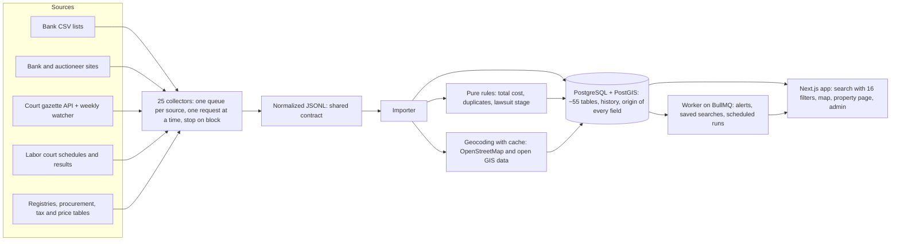

# Real Estate Auction Search: Case Study

> A search platform that gathers foreclosure and court-ordered real estate auctions in São Paulo from banks, auctioneers, and official court gazettes into one normalized database, with the real total cost of buying, lawsuit stage tracking, a map, alerts, and an admin panel. Built for a law firm.
> **Source code is private.** This repository documents the project; a live walkthrough is available on request.

**Stack:** TypeScript monorepo (pnpm workspaces) with four packages: collectors, core rules, worker, and web. Next.js 15, PostgreSQL 16 with PostGIS, BullMQ on Redis, Leaflet with OpenStreetMap, SQL migrations with undo scripts, Argon2id passwords, Docker Compose locally and on the demo server, one Python helper for the weekly court gazette pull.

**Status:** demo. The full system runs locally for a São Paulo pilot; a reduced demonstration (a fixed sample of properties, a demo user, and an admin login that sees everything) is published on a private address, hidden from search engines, for the client to evaluate. The engagement proposal had not been accepted at the time of writing; the first stage was built in advance.

## Problem → Solution

**Problem.** Properties going to auction in São Paulo are scattered across bank portals, dozens of auctioneer sites, and daily court gazettes. Each source has its own format, many hide the key data in PDFs, and the real cost of buying (auctioneer commission, transfer tax, registry, unpaid condominium and property tax, eviction) is never shown next to the price. A lawsuit that will end in an auction gives signals months earlier, but only to someone reading the gazette every day. Lawyers were checking each source by hand.

**Solution.** Polite collectors for each open source feed a single normalized database where every field keeps its origin and verification date. Business rules compute the total cost with the origin of every number, classify lawsuits into four stages with evidence, and flag duplicates across sources. A web app offers search with 16 filters, a radius search on the map, property pages with price history, saved searches with alerts, and an admin panel for source health and manual corrections.

## What I built

- **Source research.** 42 public sources tested one by one for terms of use, robots rules, data format, and a safe request rate, each with a verdict: collect, link only, or out. A second round documented new candidates (federal court, municipal property sales, transfer-tax records, bankruptcy notices) with the reason each one matters and the test needed before adding it.
- **25 collectors, one contract.** One collector per source (bank CSV lists, bank and auctioneer sites, the national court gazette API and its weekly watcher, labor court schedules and results, public procurement and federal debt listings, official auctioneer registries, transfer-tax and price-index tables), all writing the same normalized JSONL contract. Collectors run one request at a time, incrementally, and stop on any anti-bot block instead of working around it.
- **One normalized database.** About 55 tables over 31 migrations, each with an undo script: properties, offers, lawsuits, documents, costs, sources and collection runs, users and roles, searches, alerts, and a geocoding cache. Unknown is stored as unknown, never as zero; nothing is deleted; price and status changes become history.
- **Court gazette pipeline.** A rule-based filter picks auction notices out of daily publications and classifies each lawsuit into four stages (potential, attached, sale in preparation, auction announced), always with the evidence text and its date. The coverage report shows how many lawsuits sit in each stage.
- **Total cost estimate.** Price plus eight cost items, each labeled with where the number came from, and a clear warning when the total is incomplete.
- **Duplicate detection.** The same property listed by several sources is flagged; it is merged automatically only when the land registry number and the registry office match, otherwise it waits for a human in the admin panel.
- **Search, property page, and map.** 16 filters carried in the URL (city, district, postal code, radius, type, price, discount, area, rooms, parking, modality, occupancy, financing, documents, auction date, status), radius search on a Leaflet map, mobile friendly, 27 screens in total.
- **Accounts, saved searches, and alerts.** Three roles with server-side permission checks, Argon2id passwords, and in-app alerts for new listings or price drops, computed by the worker.
- **Admin panel.** Source health and on/off switch, failed collections, duplicate review, manual corrections with a full audit trail, and a data-retention policy document for personal data found in notices.
- **Demo with two faces.** One address serves a demo user who sees a reduced, read-mostly version with a fixed sample, and an admin who sees the whole system; the build is tagged with its commit so the running version can be checked from the server.

## Architecture

- A written data contract between collectors and importer let several parts be built in parallel by different coding agents without stepping on each other.
- Business rules (cost, duplicates, lawsuit stage) are pure functions with no database or network, so they are fully unit tested.
- Free and open services only: OpenStreetMap maps, open postal-code and city GIS data, all calls cached.
- Respecting the sources is a product rule: no CAPTCHA, login, or robots bypass, ever.

## Technical challenges

- **Forty-two sources, one schema.** Every source disagrees on what a property is. The contract fixes the fields, their units, and the rule "unknown stays unknown", and each collector is tested against saved samples of its source so a layout change breaks a test, not production data.
- **Reading the gazette without a model.** Auction notices are a small fraction of daily publications. A rule-based filter with explicit evidence proved more auditable for lawyers than a language model, and the four-stage classification keeps the evidence text and date next to every verdict.
- **Being honest about cost.** The headline discount is misleading when transfer tax, commission, debts, and eviction are missing. The estimate lists each item with its origin and refuses to present an incomplete total as final.
- **Duplicates without false merges.** Addresses are written differently by every source. Automatic merging only on registry number plus registry office keeps false merges at zero; everything else goes to a review queue.
- **Shipping a demo without exposing the client's data.** The demo serves a fixed sample on a hidden address with its own user, keeps the full system local, and follows a written retention rule for the personal data that appears in public notices.

## Scale

- 387 commits, built in November 2026
- About 49,500 lines of TypeScript across four packages (collectors 11,050; core 5,160; worker 2,410; web 30,870)
- 98 test files with 971 test functions
- 42 sources researched, 25 collectors implemented
- 31 SQL migrations with undo scripts, about 55 tables
- 27 screens, 16 search filters, 4 lawsuit stages
- 19 project documents: scope, data model, collection contract, source reports, coverage, deploy runbook, user manual, retention policy

## My role

Product discovery with the client, source research and legal and technical feasibility, data modeling, architecture, and full-stack development (collectors, database, business rules, web app, authentication, worker), coordinating several AI coding agents working in parallel from a shared contract and reviewing every delivery before it entered the main branch.

---
Built by **Victor Sestrem** · [LinkedIn](https://www.linkedin.com/in/victor-sestrem/) · victor-sestrem@hotmail.com
